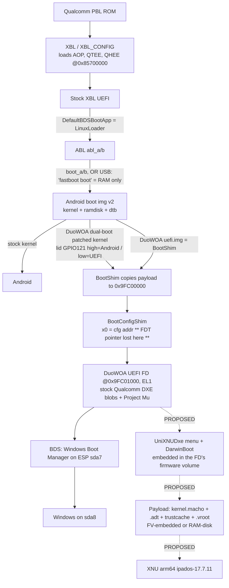
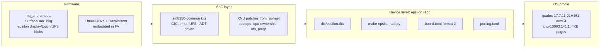

# architecture.md — Project iPhoneDuo proposed architecture

**Status:** Phase 0 (2026-11-16). Consolidated from Tracks A/B/C/D. This is a *proposed* architecture for the arm64 bring-up track; every hardware constant is subject to on-device verification (see compatibility.md §5).

## 1. Objective

**Primary target: iOS 27 (`ipados-27.0.1-24A446`, arm64e) on Surface Duo 1 (epsilon, SM8150)**, **without modifying Android or Windows-on-ARM**. Native arm64e/PAC on epsilon is **UNVERIFIED-PENDING-HARDWARE** and is the central open problem (compatibility.md §2–3, decisions/0005); the demonstrated route on non-PAC hardware is the offline arm64e→arm64 rewrite pipeline, developed host-side against lawful images.

The **`ipados-17.7.11-21H461` arm64** profile is retained as an **optional boot-chain diagnostic**: it exercises the same UEFI → DarwinBoot → XNU path with a known-good arm64 kernel and no PAC dependency, and is the resolvable config for host tooling today. Dual-screen and the iPhoneDuo identity remain later phases.

## 2. Boot chain (existing + proposed insertion)

**Insertion point:** embed `UniXNUDxe` + `DarwinBoot` into the DuoWOA UEFI firmware volume and boot the whole thing via **`fastboot boot`** (RAM-only; see compatibility.md B-FW3 for the one GPT-attribute caveat). This preserves `boot_x`, ESP and Windows.

**Critical gap (compatibility.md B-FW1):** DuoWOA's `BootConfigShim` overwrites x0, so UniXNU's normal **FDT-based payload discovery is broken** on epsilon. Two options:
- **(P1) FV-embedded payload** — carry `kernel.macho`/`.adt` as FV files; no initrd, no FDT dependency. *Simplest; recommended for first boot.*
- **(P2) Shim/PrePi fix** — stash ABL's x0 and re-publish the entry-argument HOB so initrd discovery works. *Needed if we later want a large RAM-disk root.*

## 3. Layered responsibilities (UniXNU model)

| Layer | Repo / artifact | Source |
|---|---|---|
| Framework | `UniXNU/UniXNU@21d683d` | upstream |
| OS profile | `ipados-17.7.11-21H461` (arm64) | upstream |
| SoC | `sm8150-common@f8bc872` kits + `raphael@1c435f2` XNU patches | adopt, rename to epsilon |
| Device (**new**) | `UniXNU-epsilon` (format 2: `board.toml`, `porting.toml`, `dts/epsilon.dts`, `make-epsilon-adt.py`) | author, modelled on raphael + zeta methods |
| Firmware | `mu_andromeda SurfaceDuo1Pkg@613e2eac` + embedded UniXNU/DarwinBoot | integrate (pattern from guacamole's Aloha patch) |

## 4. Hardware abstraction (arm64 track)

- **CPU/GIC/timer:** `sm8150-common` `RaphaelBootCpu`/`RaphaelGicLocal`, **single CPU first**. Timer INTID **must be parameterised from the ADT** (epsilon virtual=19; ArmCpu's hardcoded 27 is SM8350 — compatibility.md B1). Measure phys-vs-virt on hardware.
- **Storage:** raphael read-only-extents UFS model; root as **immutable files in Android `/data`** or **RAM-disk**; Data volume in RAM (`RamBlock`). **No GPT changes** (decisions/0004).
- **Display:** left panel GOP (1350x1800) via DuoWOA's patched `DisplayDxe`; XNU early console follows `boot_args->Video` and treats the region as possibly write-back (cepheus lesson). Dual-panel deferred.
- **Input/log:** buttons via stock UEFI; no physical UART → framebuffer or kernel DWC3 console for logs.
- **ADT:** generated by a format-2 flow (`dts/epsilon.dts` extends `sm8150-common/dts/sm8150.dtsi`; common `make-adt.py`), honouring zeta's required `/chosen` contract properties (random-seed 256 B, unique-chip-id, `/product`, NVRAM proxy, `kern.maxvnodes`).

## 5. Major dependencies

- Host build: UniXNU toolchain (linux/macOS), `dtc`, Python 3, Capstone (for any PAC tooling — long-term only), Xcode/macOS runner for XNU link (per raphael/zeta CI). Exact prereqs validated in Phase 1 task T1 (host build).
- External: Apple IPSW for `ipados-17.7.11-21H461` (kept **out of git**; licensing per decisions). Stock epsilon firmware blobs come from `SurfaceDuoBinaries` (already in MU).
- Pins recorded in `handoff.md` and `progress.md` (P0-T0).

## 6. Open architectural decisions

See `docs/decisions/`: 0001 OS profile, 0002 SoC donor, 0003 firmware base + payload discovery, 0004 non-destructive storage, 0005 iOS-27 deferral.
